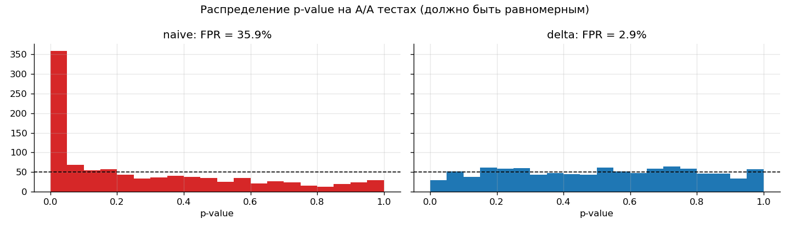
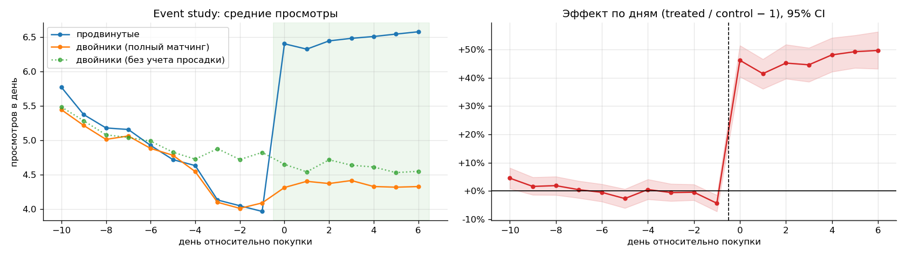

# Аналитика маркетплейса недвижимости

Представим сервис объявлений о продаже и аренде жилья в Казахстане. С одной стороны — люди, которые ищут квартиру, с другой — продавцы, агенты и их объявления. В этом проекте я разбираю такой продукт так, как это делал бы продуктовый аналитик внутри команды: смотрю на здоровье продукта, решаю, выкатывать ли новую фичу по итогам A/B теста, и считаю, сколько на самом деле приносит платная услуга.

## Откуда данные

Данные синтетические — их собирает генератор [`src/generate_data.py`](src/generate_data.py). Я старался, чтобы они вели себя как настоящие: с недельной сезонностью, с агентами, которые дают непропорционально много активности, и с самоотбором — платное продвижение покупают не случайные люди, а те, у кого объявление просело.

У синтетики есть приятный бонус: я знаю истинные эффекты, которые заложил в генератор. Поэтому можно не просто посчитать результат, а проверить, что метод нашел правду.

## Три вопроса

### 1. Как дела у продукта? → [01_product_metrics](notebooks/01_product_metrics.ipynb)

Аудитория (DAU/WAU/MAU), воронка по платформам, когортный retention, ликвидность объявлений.

Конверсия из просмотра в контакт — около 6.5%, при этом на вебе она ниже (5.9%) и просмотров на человека там меньше. Аудитория сильно неравномерна: 10% самых активных пользователей дают 44% всех просмотров. Со стороны объявлений картина ожидаемая, но теперь в цифрах: если цена на 15%+ выше медианы по району или в объявлении нет фото, контактов заметно меньше.

### 2. Выкатывать ли новую карточку объявления? → [02_ab_test_listing_card](notebooks/02_ab_test_listing_card.ipynb)

Конверсия просмотр → контакт выросла на **+2.8%** (CUPED, p ≈ 0.01), guardrail-метрики не пострадали. Но если разрезать по платформам, весь эффект — в мобильных приложениях, на вебе около нуля. Мое решение: раскатываем на приложения, а веб отдаем на доработку.

По дороге проверяю всё, что обычно ломает выводы: SRM, A/A на предпериоде, дельта-метод для ratio-метрик, линеаризация, бутстрап, поправка Холма для сегментов.



Этот график — главная причина, почему конверсию нельзя считать обычным z-тестом по просмотрам. На 1000 A/A тестах наивный подход «находит» эффект в 25% случаев вместо положенных 5%. Дельта-метод держит честные 5%.

### 3. Сколько реально дает платное продвижение? → [03_promotion_effect](notebooks/03_promotion_effect.ipynb)

Если просто сравнить «до» и «после» покупки, получается +60% к просмотрам. Звучит отлично, но это неправда: продвижение покупают сразу после просадки, и часть роста — обычный возврат к норме, который случился бы и без денег.

Чтобы отделить эффект от самоотбора, я подбираю похожие объявления без продвижения (модель склонности + matching) и сравниваю динамику через difference-in-differences, а плацебо-тестом проверяю, что метод не видит эффект там, где его нет. Итог: **+46% просмотров и +30% контактов**. В генераторе было заложено +45% и +30% — метод попал.



## Что еще есть в репозитории

- [`src/abtest.py`](src/abtest.py) — мои функции для A/B тестов: SRM, дельта-метод, CUPED, бутстрап, Холм, MDE. Покрыты тестами в [`tests/`](tests/), в том числе проверкой, что дельта-метод держит FPR на A/A.
- [`sql/`](sql/) — запросы на BigQuery: сборка витрин из сырых событий, воронка, retention и расчет эксперимента с дельта-методом прямо в SQL.
- [`dags/`](dags/) — DAG для Airflow: каждый день пересобирает витрины, проверяет, не сломались ли данные, и ищет SRM в активных экспериментах — чтобы узнать о сломанном сплите на второй день теста, а не в конце.

## Как запустить

```bash
pip install -r requirements.txt
python src/generate_data.py --out data      # пара секунд, ~1.2 млн строк
pytest tests
jupyter lab notebooks/
```

## Данные

| таблица | одна строка — это | поля |
|---|---|---|
| `users` | пользователь | платформа, город, роль (buyer / renter / seller / agent), дата регистрации |
| `user_daily` | пользователь × день | сессии, поиски, просмотры объявлений, избранное, контакты |
| `exp_exposures` | пользователь | эксперимент, вариант, дата первой экспозиции |
| `listings` | объявление | город, район, тип сделки, тип продавца, комнаты, площадь, цена, кол-во фото |
| `listing_daily` | объявление × день | просмотры, контакты, флаг продвижения |
| `promotions` | покупка | объявление, дата начала, пакет |

Контакт — это показ телефона или первое сообщение в чат по объявлению.

## Что хочу сделать дальше

- Uplift-модель: кому вообще стоит предлагать продвижение, — и проверить ее A/B тестом рекомендации.
- Эксперимент на стороне продавцов: подсказка рыночной цены при подаче объявления.
- Sequential testing, чтобы можно было подглядывать в результаты теста до его окончания, не раздувая ошибки.
